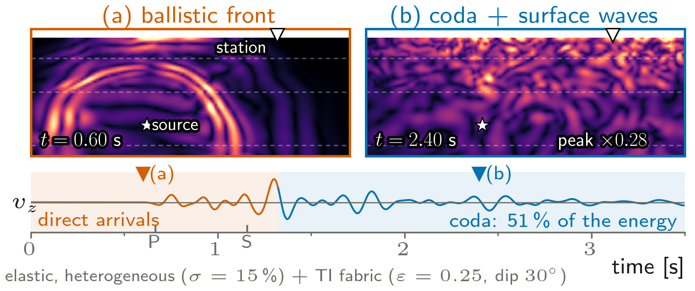

# semwave

2-D plane-strain spectral-element elastodynamics on random media, with an optional
transversely isotropic fabric and an optional Lemaitre--Chaboche visco-plastic surficial
layer.

| module | what it is | needs FEniCSx |
| --- | --- | --- |
| `semwave.random_field` | Shinozuka--Deodatis von Karman fields, layered-cake background $V_{s0}(z)$, Lame parameters, Gardner density | no |
| `semwave.anisotropy` | transversely isotropic stiffness from Thomsen $\epsilon,\delta$, and the 2-D Christoffel phase velocities that check it | no |
| `semwave.chaboche` | J2 visco-plasticity: Norton flow, Armstrong--Frederick kinematic and Voce isotropic hardening, integrated implicitly | no |
| `semwave.sem_wave` | `SEMWave2D`: GLL spectral elements, lumped mass, explicit central differences, Ricker point force or extended fault, Cerjan sponge, free surface, Rayleigh damping, optional tilted TI fabric | **yes** |
| `semwave.sem_wave_vp` | `SEMWaveVP2D`: the same, with the stress carried at the GLL points so a surficial layer can be visco-plastic | **yes** |

## Scientific outputs

The repository includes the figures produced for the HDR presentation,
together with the SEM workflows used to regenerate the main wave-propagation
results.

[](docs/hdr-gallery.md)

See the [complete HDR gallery](docs/hdr-gallery.md) and the
[reproduction workflows](examples/hdr/README.md).

The FEniCSx-dependent solvers are imported lazily, so `random_field` and `chaboche` work on a plain
numpy/scipy install:

```python
import numpy as np
from semwave import shinozuka_deodatis_2d, Chaboche     # no dolfinx needed
```

## Use it from another location

**1. On the path** — nothing to install:

```bash
export PYTHONPATH=/path/to/semwave:$PYTHONPATH
```

**2. Installed** — editable, so edits here take effect everywhere:

```bash
pip install -e /path/to/semwave
```

`dolfinx` is not on PyPI and is deliberately **not** a declared dependency: install it with
conda/apt, or use the FEniCSx image below.

**3. In the FEniCSx container.** Mount the package and put it on `PYTHONPATH` — but *keep the
image's own entries*, which are what make `dolfinx` importable. Overwriting `PYTHONPATH` instead of
prepending to it is the one mistake that will cost you ten minutes:

```bash
SEMWAVE=/path/to/semwave
DOLFIN=/usr/local/dolfinx-real/lib/python3.12/dist-packages:/usr/local/lib
docker run --rm --user "$(id -u):$(id -g)" -e HOME=/tmp -e MPLCONFIGDIR=/tmp \
    -e PYTHONPATH="/semwave:$DOLFIN" \
    -v "$SEMWAVE":/semwave -v "$PWD":/work -w /work \
    fenicsx-jupyter python3 your_script.py
```

## Quickstart

```python
import numpy as np
from semwave import SEMWave2D

sim = SEMWave2D(L=2000., H=1200., nx=40, ny=24, degree=4,
                f0=6.0, t_end=3.0, q_damp=80.0, alpha_damp=1.2)
sim.set_medium(np.random.default_rng(1), n_grid=(241, 145),
               sigma_ln=0.15, b1=250., b2=100.)
sim.run(src_xy=(800., 450.), rec_xy=[(1600., 1199.), (1600., 900.)],
        snap_at=(0.35, 2.2))
gx, gy, snap = sim.snapshot_grid(which=1)     # velocity magnitude on a grid
t, v = sim.time, sim.trace                    # station 0, vertical velocity
vz, vx = sim.traces, sim.traces_x             # every station, both components
```

`rec_xy` takes one station or a list of them; `trace` stays the vertical velocity of
station 0, so older scripts are unaffected. The triangulation behind `snapshot_grid` is
built once per solver, so pulling a whole movie of snapshots out of one run is cheap.

## An anisotropic medium

The random medium is isotropic point by point. Sediments are not: fine layering, aligned
platelets and aligned cracks make them faster along the fabric than across it, and at
these wavelengths the stack is not resolved but *felt*, as an effective transversely
isotropic medium (Backus, 1962). `set_anisotropy` adds that fabric on top of the Lame
fields, parameterised by Thomsen (1986) $\epsilon$, $\delta$ and a symmetry axis tilted
by `theta` from the vertical:

```python
sim.set_medium(np.random.default_rng(1), n_grid=(261, 131), sigma_ln=0.15)
sim.set_anisotropy(epsilon=0.25, delta=0.10, theta=np.deg2rad(30.))

# or a fabric that fades with depth, as compaction destroys it
sim.set_anisotropy(epsilon=lambda x1, x2: 0.25 * np.exp(-(H - x2) / 600.),
                   delta=lambda x1, x2: 0.10 * np.exp(-(H - x2) / 600.),
                   theta=np.deg2rad(30.))

v_qp, v_qsv = sim.phase_velocity(np.deg2rad([0., 45., 90.]))   # the check
```

Each parameter is a number, an `(n_x2, n_x1)` array on the grid of `set_medium`, or a
callable `f(X1, X2)` evaluated on it. In the fabric frame the stiffness is

$$C_{33}=\lambda+2\mu,\quad C_{55}=\mu,\quad C_{11}=C_{33}(1+2\epsilon),\quad
  C_{13}=\sqrt{2\delta C_{33}(C_{33}-C_{55})+(C_{33}-C_{55})^2}-C_{55},$$

so that $\epsilon=\delta=0$ returns Hooke exactly -- and it does, to 1e-12 on a receiver
trace. The strain is rotated into the fabric frame, the law applied there and the stress
rotated back, which costs one 2x2 product per quadrature point and nothing else.

Three things are worth knowing:

* **the time step follows the fabric.** The CFL speed is the largest qP *phase* velocity
  over every point and every direction, which `set_anisotropy` computes from the
  Christoffel matrix and folds into `dt`. For $\delta>\epsilon$ the an-elliptic front
  bulges past both the axis and the fabric, so $\sqrt{1+2\epsilon}\,V_p$ would not be
  enough. Call `set_anisotropy` **after** `set_medium`, which is enforced;
* **not every $(\epsilon,\delta)$ pair is a medium.** Chosen independently they can break
  $C_{11}C_{33}>C_{13}^2$; the setter checks it on the sampled fields and raises;
* **`SEMWaveVP2D` refuses a fabric.** It carries the stress at the quadrature points
  through an isotropic elastic increment (`chaboche.py`), so a TI fabric would have to go
  into the constitutive update as well. It raises `NotImplementedError` instead of
  quietly dropping the anisotropy.

A visco-plastic top 150 m, with a soil-like strength and several stations:

```python
from semwave import SEMWaveVP2D

vp = SEMWaveVP2D(L=2000., H=1200., nx=40, ny=24, degree=4,
                 f0=6.0, t_end=3.0, q_damp=80.0, alpha_damp=1.2)
vp.force_amp = 1.5e9                          # scale the source to the strength
vp.set_medium(np.random.default_rng(1), n_grid=(241, 145),
              sigma_ln=0.15, b1=250., b2=100.)
vp.set_plastic_layer(depth=150.0, yield_strain=1.0e-4,
                     c_kin=5.0, gamma=100.0, q_iso=0.2, b_iso=150.0,
                     k_visc=0.5, n_visc=3.0)   # hardening/viscosity as multiples of sigma_y
vp.run(src_xy=(800., 450.),
       rec_xy=[(1600., 1199.), (1600., 1125.), (1600., 900.)],
       snap_at=(0.35, 2.2))
print(vp.traces.shape, vp.pacc.max(), vp.n_yield_events)
```

## How the visco-plastic solver works

The GLL quadrature of degree $2p-1$ has exactly the $(p+1)^2$ GLL nodes of degree $p$ as its
points, so the stress and the internal variables live on the collocation nodes and the lumped-mass
central-difference update is unchanged:

$$f_{\rm int}(\sigma^n)\;\to\;u^{n+1}\;\to\;\Delta\varepsilon=\varepsilon(u^{n+1}-u^n)\;\to\;
  \sigma^{n+1}=\mathrm{chaboche}(\sigma^n,\Delta\varepsilon).$$

The flow increment solves the radial-return consistency equation

$$\Phi(\Delta p)=J_{\rm tr}-3\mu\Delta p-\frac{\Delta p\,(C-\gamma X_{\rm eq})}{1+\gamma\Delta p}
  -\sigma_y-\frac{R+bQ\Delta p}{1+b\Delta p}-K\Bigl(\frac{\Delta p}{\Delta t}\Bigr)^{1/n}=0,$$

which is strictly decreasing with $\Phi(0)=f_{\rm tr}>0$ and $\Phi(f_{\rm tr}/3\mu)\le0$: the root
is bracketed a priori, so vectorised bisection cannot fail and needs no cap on $\Delta p$. An
explicit update was tried first and discarded — the cap it needs ends up governing the answer
instead of the rheology.

**Calibration matters.** Set the strength from a yield strain (`yield_strain`, e.g. $10^{-4}$ for
soil) and scale the *source* (`force_amp`) to the shaking you want. Scaling the strength to the
event instead gives plastic strains of tens of percent for any visible effect. The hardening and
viscous parameters are illustrative multiples of $\sigma_y$: this is a rheology for showing a
mechanism, not a calibrated soil model.
