# HDR scientific figure gallery

These figures were prepared for Filippo Gatti's HDR presentation.  They are
kept with the solver so that the numerical methods, the scientific narrative,
and the resulting visual evidence remain together.  Reproducible SEM-based
workflows are documented in [`examples/hdr`](../examples/hdr/README.md).

## Random media and wave propagation

| | |
| --- | --- |
| 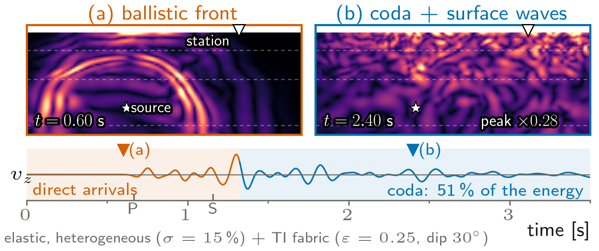 | 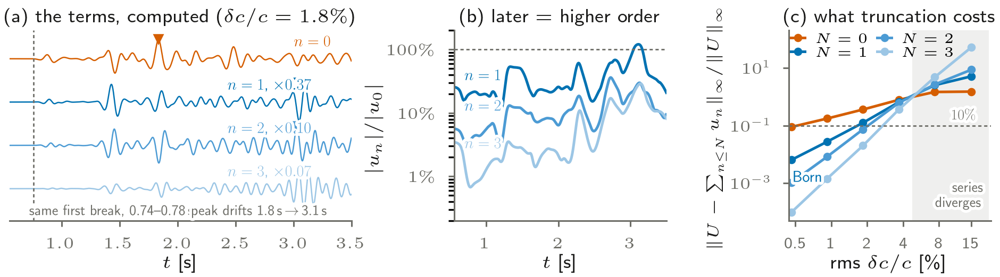 |
| Ballistic front, scattered coda, and receiver record. | Computed Neumann terms and truncation behaviour. |
| 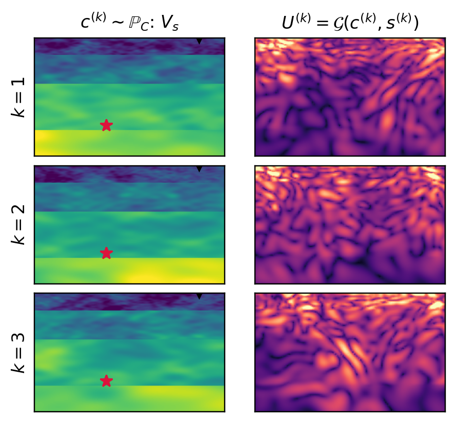 | 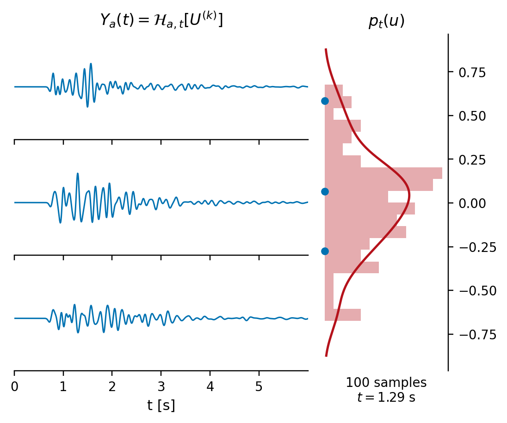 |
| Realisations of the heterogeneous medium. | Receiver variability across the ensemble. |
| 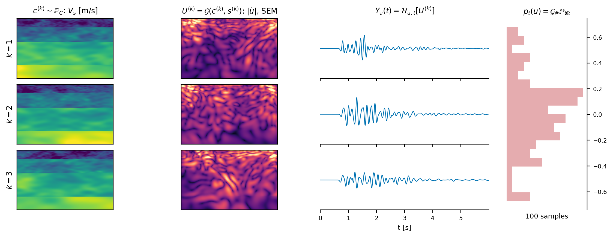 | 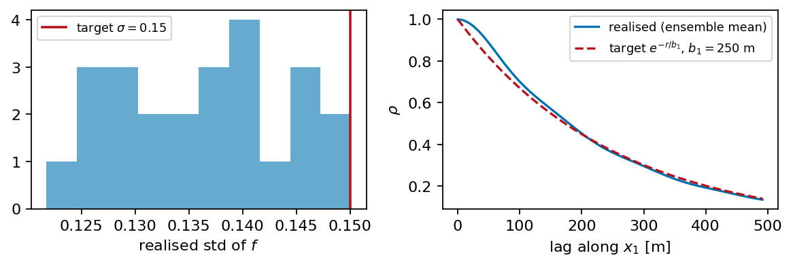 |
| Ensemble-level stochastic response. | Spectral-representation quality checks. |
| 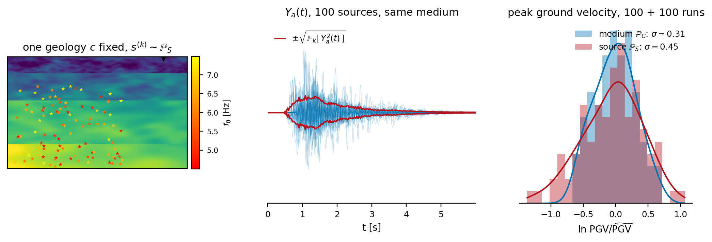 | 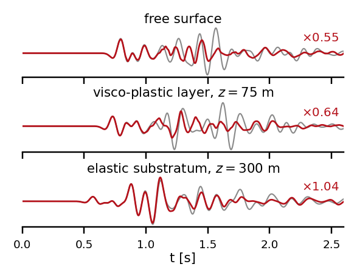 |
| Separation of source and propagation effects. | Amplitude-dependent nonlinear response. |

## Anisotropy and nonlinear soils

| | |
| --- | --- |
| 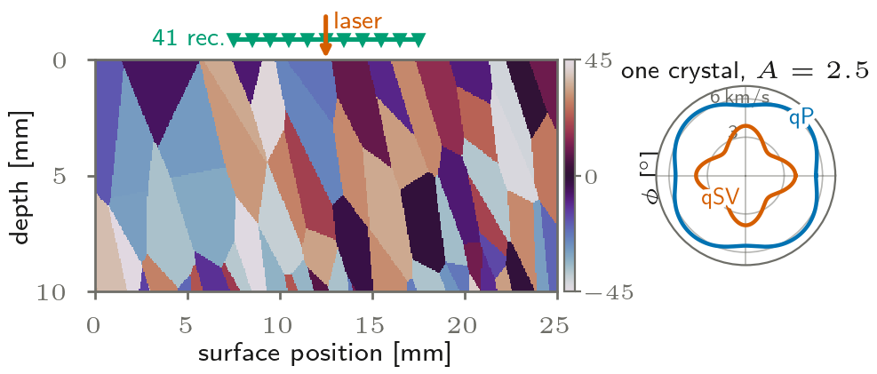 | 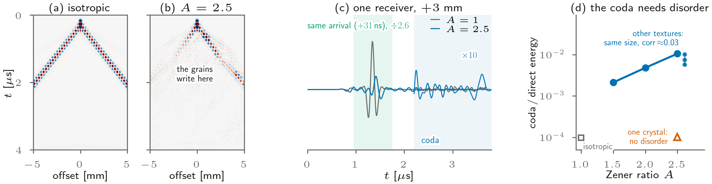 |
| Synthetic polycrystal fabric and acquisition geometry. | Texture-dependent coda in laser ultrasonics. |
| 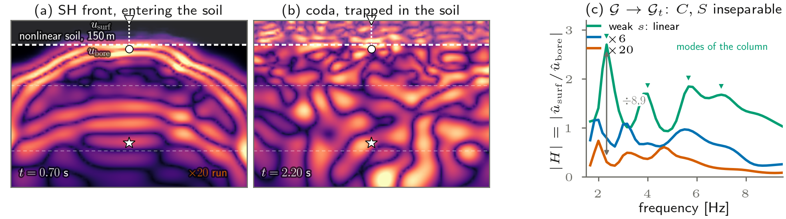 | 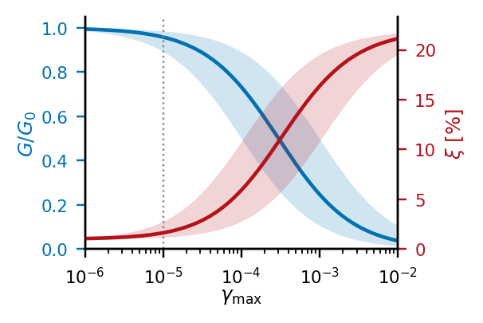 |
| Amplitude-dependent soil-column transfer function. | Constitutive degradation at increasing strain. |

## Sources, scales, and computational setting

| | |
| --- | --- |
| 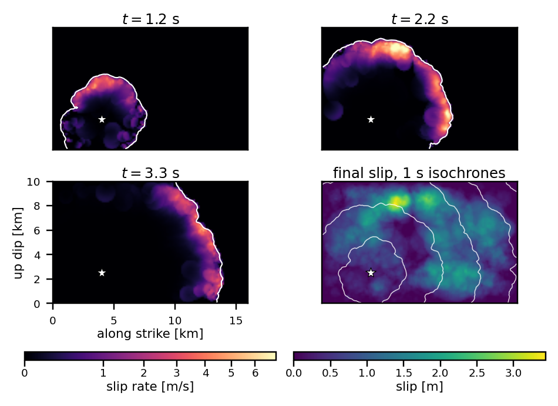 | 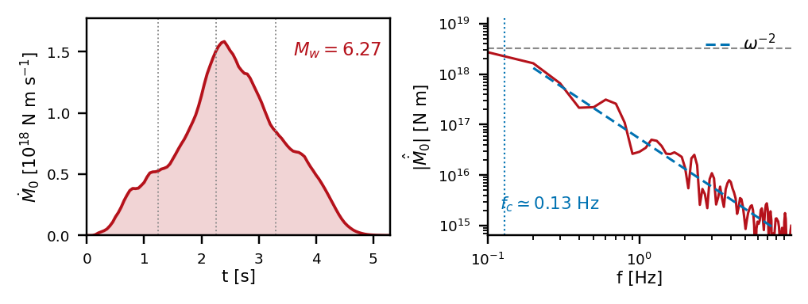 |
| Extended-fault rupture front. | Frequency content of the rupture. |
| 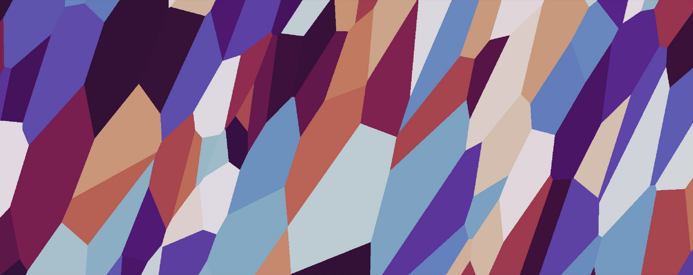 | 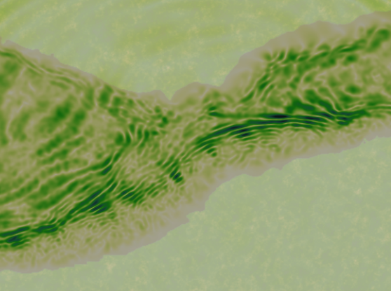 |
| Grain-scale heterogeneity. | Basin-scale propagation. |
| 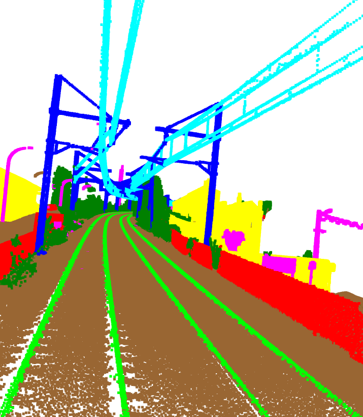 | 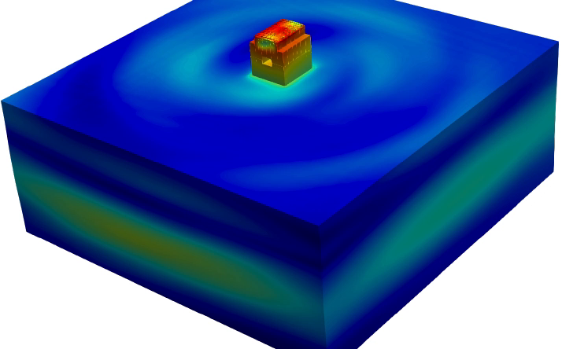 |
| Surveyed railway infrastructure. | Soil--structure interaction model. |
| 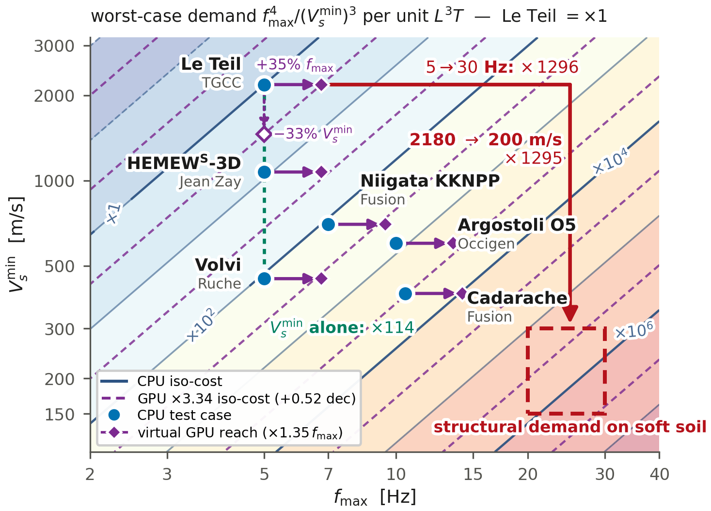 | 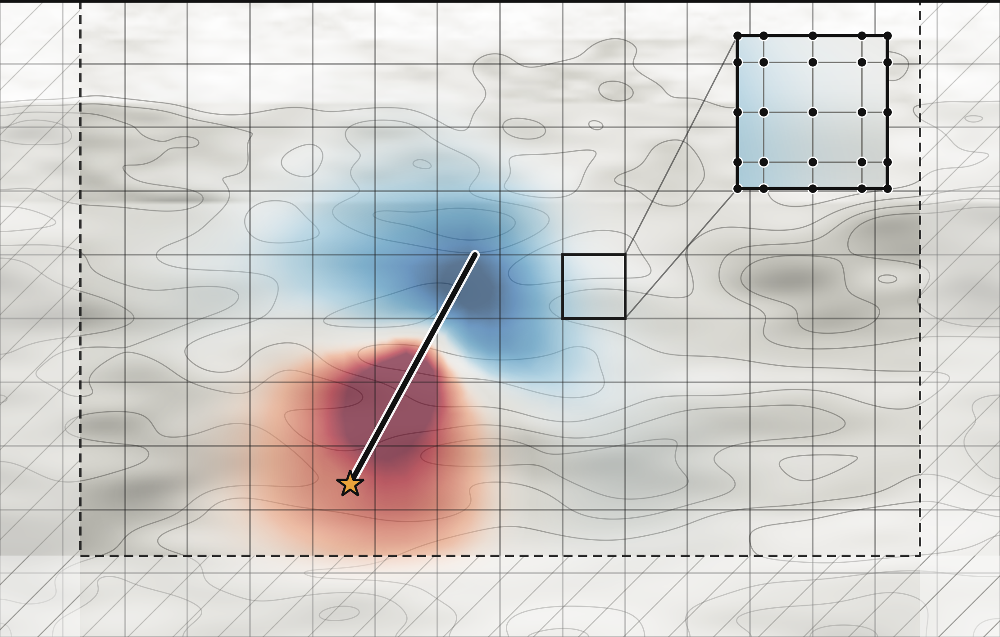 |
| Resolution-driven computational demand. | Heterogeneous fault wavefield and SEM mesh. |

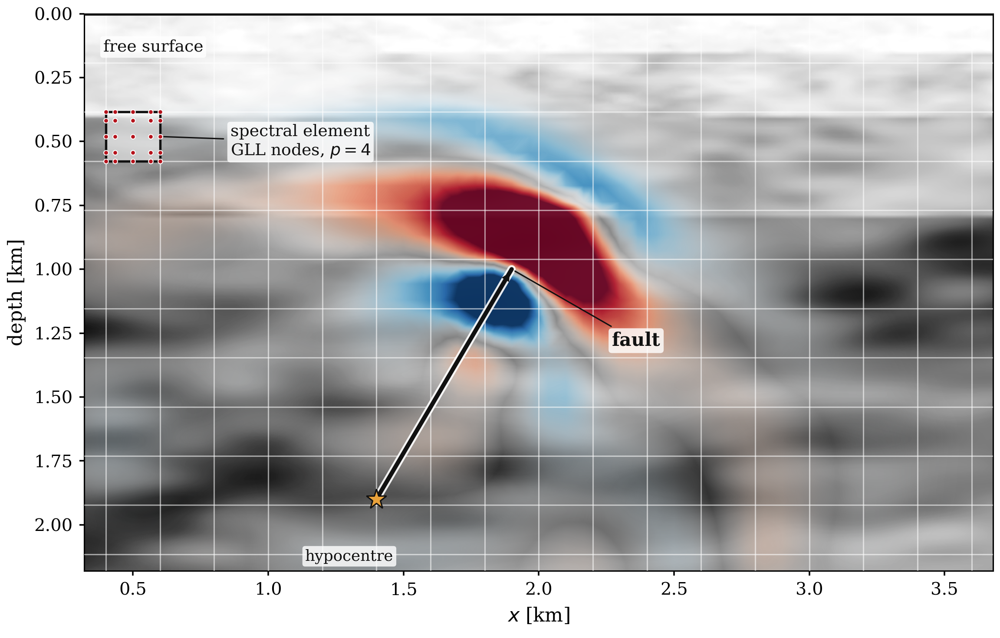

Detailed heterogeneous fault wavefield with its spectral-element mesh.
